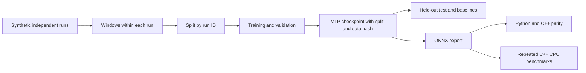
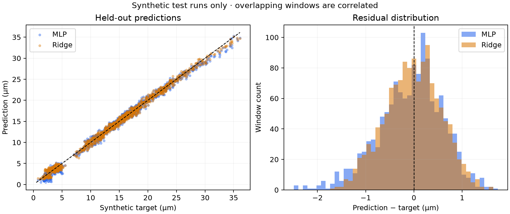

# Physics-Inspired Thermal Drift Forecasting with ONNX and C++

[](https://github.com/canrefih/physics-informed-edge-ai/actions/workflows/validate.yml)

A compact research prototype that forecasts synthetic thermal drift from temperature and vibration windows, trains a PyTorch MLP, and runs the exported model in Python and C++ using ONNX Runtime.

> **Scope:** All data is synthetic. This project demonstrates a forecasting and deployment workflow; it has not been validated on industrial machinery or edge hardware. The full-window linear and ridge baselines outperform the MLP in the recorded experiment below.

## Why “physics-inspired”?

The simulator uses a simplified exponential warm-up curve and a hand-written relationship between temperature, vibration, and drift. Training uses ordinary mean squared error. No physical equation residual, boundary condition, or conservation constraint is included in the loss or model architecture. This is **not a physics-informed neural network (PINN)**. The repository name is retained for continuity.

## Workflow



## Data and prediction contract

Default generator settings:

| Property | Value |
|---|---|
| Independent simulated runs | 60 |
| Samples per run | 200 |
| Sampling interval | 0.1 s |
| Input | 32 time steps × 2 channels, float32 |
| Channel order | Temperature delta (°C), synthetic vibration |
| Temperature reference | First measured temperature of that run |
| Vibration units | Arbitrary synthetic units; no calibrated sensor units |
| Target | Drift in millimeters, 20 steps (2 s) after the last input sample |
| Windows | 149 per run; 8,940 total |

The 32 sample timestamps span 3.1 s. Overlapping windows are created within runs and never cross run boundaries. With seed 42, the split contains 42 training, 9 validation, and 9 test runs (6,258 / 1,341 / 1,341 windows). Windows from one run stay in one split. Overlapping test windows are correlated; their count is not a count of independent experiments.

At each simulated time step the target equation is:

```text
drift_mm = 0.010 * temperature_delta_c
         + 0.004 * vibration
         + 0.00035 * max(temperature_delta_c - 3.0, 0)^2
         + noise
noise ~ Normal(0, 0.00008 mm)
```

This is an illustrative relationship, not a calibrated machine model. The network sees only past sensor values and predicts a future target generated by that relationship. The short simulated runs do not establish coverage of full industrial warm-up cycles.

**Preprocessing is outside the ONNX graph:** divide temperature delta by 10 and leave vibration unchanged. Both runtimes must receive this same scaled input. The model flattens each window into 64 values, then applies `Linear(64,64) → ReLU → Linear(64,32) → ReLU → Linear(32,1)` (6,273 trainable parameters).

Training uses Adam (learning rate 0.001), batch size 128, CPU, and 50 epochs. The checkpoint with the lowest validation MSE is selected; the test runs are used only for final evaluation.

## Recorded synthetic evaluation

Recorded on **2026-10-21**, Python 3.14.7 on Windows 11 x64. Full precision metrics, split IDs, package versions, model/data SHA-256 hashes, and source file hashes are stored in [results/evaluation.json](results/evaluation.json). Training history is in [artifacts/model.training.json](artifacts/model.training.json).

| Estimator | MAE (mm) | RMSE (mm) | Maximum absolute error (mm) |
|---|---:|---:|---:|
| PyTorch MLP | 0.000525029 | 0.000670608 | 0.002487893 |
| Last-value proxy | 0.001715350 | 0.002012197 | 0.005037914 |
| Linear, full window | 0.000464042 | 0.000573611 | 0.001655923 |
| Ridge, full window | 0.000463513 | 0.000573334 | 0.001647085 |

The last-value proxy applies `0.010 * last_temperature_delta + 0.004 * last_vibration`, without fitting. Linear and ridge regression use the same scaled 64 input values as the MLP and include an intercept. They are fitted on training runs only. Ridge alpha is selected from `1e-6, 1e-4, 1e-2, 1.0` using validation RMSE (selected: `0.01`); the intercept is not penalized.

The MLP reduces MAE by about 69.4% relative to the last-value proxy, **but does not beat the full-window linear or ridge baselines**. These results support the deployment proof of concept, not a claim that a neural network is the best estimator. They are one split and one training seed, not an uncertainty estimate or industrial accuracy measurement.



## Requirements and setup

The recorded environment uses Windows 11 x64, Python 3.14.7, NumPy 2.5.4, PyTorch 2.14.1, ONNX 1.23.2, ONNX Runtime 1.31.0, ONNX Script 0.7.2, pytest 9.1.1, and Matplotlib 3.11.2.

`requirements-tested.txt` pins the tested top-level packages; it is not a complete transitive dependency lock. `requirements.txt` lists broader minimum versions, which have not all been tested. Exact training results can vary across software and hardware.

From PowerShell:

```powershell
git clone https://github.com/canrefih/physics-informed-edge-ai.git
cd physics-informed-edge-ai
python -m venv .venv
.\.venv\Scripts\Activate.ps1
python -m pip install -r requirements-tested.txt
```

If activation is unavailable, run `.\.venv\Scripts\python.exe` directly in place of `python`.

The C++ demo requires CMake **3.20+**, Visual Studio C++ build tools with an MSVC compiler and Windows SDK, and a Windows x64 build environment. ONNX Runtime 1.31.0 headers, import library, runtime DLLs, and upstream notices are included under `third_party/onnxruntime-win-x64-1.31.0/`. Other C++ platforms and toolchains have not been validated.

## Reproduce the experiment

Run from the repository root:

```powershell
python scripts/generate_data.py --seed 42
python scripts/train.py --epochs 50 --seed 42 --threads 1
python scripts/evaluate.py
python scripts/export_onnx.py
python scripts/plot_results.py
python -m pytest tests/ -v --junitxml=results/tests.xml
```

These commands overwrite the default dataset, checkpoint, exported model, and reports. The generated dataset and prediction arrays are excluded from Git and can be regenerated.

Training saves the exact train/validation/test run IDs, input scaling, dataset SHA-256, generator settings, and training settings **inside the checkpoint**. Evaluation reads that saved split, including for nondefault training seeds; it never independently reconstructs a split with a hard-coded seed. It rejects a dataset whose file hash differs and checkpoints without the required metadata. For a regenerated or changed dataset, retrain before evaluating. Legacy checkpoints must also be retrained.

The scripts support custom paths: `train.py --data ... --output ...` and `evaluate.py --data ... --model ... --output ...`. Paths are relative to the repository root unless absolute. Export and C++ commands use the default `artifacts/model.pt` and `artifacts/model.onnx`.

Reports capture timestamps, package versions, source commit, working-tree status, and hashes of relevant source files. The committed example reports were produced while preparing these changes, so `source_dirty: true` is expected; source file hashes identify the implementation used. They are snapshots, not a promise of byte-for-byte identical retraining.

## ONNX and C++ deployment

The ONNX input is `sensor_window` with shape `[batch, 32, 2]`, float32; output is `predicted_drift_mm` with shape `[batch]`. The export uses opset 17 and explicitly selects the TorchScript exporter for this small MLP. The export report is [artifacts/model.export.json](artifacts/model.export.json). The new export embeds the weights in one `.onnx` file. Older exports used `model.onnx.data`; such exports must be distributed together with their external data file.

Run the build and demo from the repository root, since the executable resolves `artifacts/model.onnx` relative to its working directory:

```powershell
cmake -S . -B build -A x64
cmake --build build --config Release
.\build\Release\edge_ai_cpp.exe
python scripts/compare_cpp.py
python scripts/benchmark_cpp.py --runs 3
```

Python/C++ parity checks a zero window, the demonstration window, and 14 seeded random preprocessed windows, with absolute tolerance `1e-6 mm`. Results and individual predictions are saved in [results/cpp_parity.json](results/cpp_parity.json). This checks numerical consistency on 16 inputs; it does not establish prediction accuracy or exhaustive runtime equivalence. The separate pytest parity test compares PyTorch and Python ONNX Runtime on a batch of eight inputs.

The C++ program also accepts `--input FILE --predict-only`, where FILE contains exactly 64 finite, already-scaled floats in time-major order. This path performs one prediction without benchmarking.

## CPU latency measurement

[results/cpp_benchmark.json](results/cpp_benchmark.json) records three separate C++ process runs with the environment, executable/model hashes, settings, and printed outputs. Each uses Release mode, ONNX Runtime 1.31.0 CPU, one intra-op thread, 100 warm-up calls, and 5,000 timed calls on the same preallocated demonstration input.

| Run | Average (µs) | Median (µs) | P95 (µs) | P99 (µs) | Maximum (µs) |
|---|---:|---:|---:|---:|---:|
| 1 | 16.315 | 15.900 | 17.900 | 31.300 | 47.600 |
| 2 | 16.623 | 15.900 | 19.300 | 31.700 | 155.800 |
| 3 | 16.838 | 16.300 | 17.700 | 31.000 | 95.800 |

The timer surrounds `Session::Run`, including its output allocation. It excludes sensor acquisition, input preprocessing, startup, model loading, communication, and machine-control response. Runs on a development PC do not establish edge-device performance, hard real-time behavior, or a production latency guarantee. Compare the individual recorded runs rather than treating one minimum as a guarantee.

## Validation

The test suite covers dataset shapes and finite values, per-run window generation, invalid dataset configurations, disjoint saved splits, rejection of changed datasets and legacy checkpoints, evaluation after training with seed 7, and PyTorch/ONNX parity.

The [Windows workflow](.github/workflows/validate.yml) runs generation, training, evaluation, export, plotting, pytest, C++ compilation, Python/C++ parity, and repeated benchmarks. It uploads reports and model artifacts. Benchmark values from shared CI runners should not be treated as stable performance targets.

## Limitations and next steps

- Validate on appropriately collected real machine measurements with calibrated sensor units.
- Compare across multiple seeds and run-level splits, and report uncertainty by independent run.
- Investigate why simple full-window regression outperforms the current MLP.
- Test longer warm-up cycles, sensor noise, operating changes, and out-of-distribution conditions.
- Benchmark on the intended edge device and assess integration and control-system requirements.
- Extend parity checks and deployment validation before considering production use.

No real Rollomatic machine data or industrial validation is included. Upstream ONNX Runtime licensing and notices are under `third_party/`; the repository currently does not specify a project-level license.
