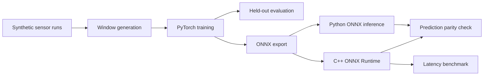

# Physics-Informed Edge AI for Precision Machining

A compact edge-AI research prototype for estimating thermal drift from temperature and vibration signals. The project explores a physics-inspired modeling approach and deploys a trained regression model through ONNX Runtime in both Python and C++.

> **Research prototype:** All experiments use synthetic data. The model has not been validated on real industrial machinery or Rollomatic equipment. Results represent a software proof of concept, not demonstrated industrial measurement accuracy.

## Project Goals

- Generate reproducible synthetic sensor sequences representing thermal warm-up and vibration.
- Train a compact PyTorch regression model to estimate future drift.
- Evaluate performance on independent held-out simulated runs.
- Export the model to ONNX for portable inference.
- Run inference from C++ using ONNX Runtime.
- Check Python/C++ prediction consistency and measure CPU inference latency.

## Architecture



## Model and Data

The synthetic dataset contains temperature-delta and vibration signals sampled at 0.1-second intervals. Each model input is a 32-step window with two features: temperature delta and vibration. The target is the simulated drift 20 sampling steps after the end of the input window, corresponding to a nominal forecast horizon of 2 seconds in the simulation.

The model is a compact multilayer perceptron (MLP): the flattened input passes through fully connected layers with 64 and 32 hidden units, using ReLU activations, before producing a single drift estimate in millimeters. Temperature delta is scaled by dividing it by 10; vibration is left unchanged.

The target equation is an illustrative synthetic relationship, not a calibrated physical model of any specific machine. The approach is physics-inspired, not a strict physics-informed neural network (PINN).

## Held-Out Synthetic Evaluation

Previously recorded evaluation results:

| Metric | Neural model | Proxy baseline |
|---|---:|---:|
| MAE | 0.000525 mm | 0.001715 mm |
| RMSE | 0.000671 mm | 0.002012 mm |
| Maximum absolute error | 0.002488 mm | 0.005038 mm |

The proxy baseline uses only the last observed temperature-delta and vibration values in each input window, applying a simple linear formula without the nonlinear temperature term. The neural model instead uses the full 32-step input window.

On the recorded held-out synthetic test set, the neural model's MAE was approximately 69.4% lower than this proxy baseline. This comparison measures performance against a simple reference, not against a validated industrial estimator or a comprehensive set of alternative models. Exact metrics may vary when the experiment is rerun.

## ONNX and C++ Deployment

The trained model is exported to ONNX and loaded by ONNX Runtime in C++. The demo uses a synthetic input window with shape `[1, 32, 2]`.

A Python/C++ consistency check produced:

```text
Python ONNX prediction : 0.034147084 mm
C++ ONNX prediction    : 0.034147000 mm
Absolute difference    : 0.000000084 mm
Allowed tolerance      : 0.000010000 mm

PASS
```

The C++ output is rounded for display, which explains the small difference.

## C++ CPU Latency Benchmark

One recorded benchmark run on the development PC:

| Setting / metric | Value |
|---|---:|
| CPU | Intel Core i7-9750H @ 2.60 GHz |
| Operating system | Windows 10 Home (OS build 26200) |
| Runtime | ONNX Runtime 1.31.0 CPU |
| Intra-op threads | 1 |
| Warm-up iterations | 100 |
| Measured iterations | 5,000 |
| Average latency | 15.544 µs |
| Median latency | 15.200 µs |
| P95 latency | 16.300 µs |
| P99 latency | 28.600 µs |
| Minimum latency | 13.700 µs |
| Maximum latency | 93.700 µs |

These statistics come from one benchmark run using repeated C++ ONNX Runtime CPU inference calls, after 100 warm-up iterations and across 5,000 measured iterations. Results may vary with system load, operating-system scheduling, and software environment.

The measurements exclude sensor acquisition, application startup, model loading, communication, and machine-control response time. They do not establish hard real-time behavior or a production-level latency guarantee.

## Requirements

- Python and the packages listed in `requirements.txt`
- CMake
- A compatible Microsoft C++ build toolchain on Windows
- ONNX Runtime C++ package compatible with the runtime linked by the project

The current development environment used Windows, MSVC, CMake, and ONNX Runtime 1.31.0.

## Reproduce the Python Experiments

From the repository root, activate your virtual environment, then run:

```powershell
python -m pip install -r requirements.txt
python scripts/generate_data.py
python scripts/train.py --epochs 50
python scripts/evaluate.py
python scripts/export_onnx.py
python -m pytest tests/ -v
```

Training and evaluation regenerate results from synthetic data, so exact metric values may change with configuration, random seeds, or software versions.

## Build and Run the C++ Demo

The ONNX Runtime C++ headers, import library, and runtime DLL are expected under `third_party/onnxruntime-win-x64-1.31.0/`.

```powershell
cmake -S . -B build -A x64
cmake --build build --config Release
.\build\Release\edge_ai_cpp.exe
```

Check Python/C++ prediction consistency with:

```powershell
python .\scripts\compare_cpp.py
```

## Tests

The current test suite covers dataset shape and finite values, run-level window isolation, invalid dataset configurations, and PyTorch/ONNX prediction parity. The latest recorded run passed all five tests.

## Limitations and Future Work

- Validate the approach using real, appropriately collected machine data.
- Compare against stronger, documented baselines.
- Add prediction-versus-target and residual plots.
- Repeat latency measurements across runs and target hardware.
- Assess robustness to sensor noise, operating conditions, and distribution shift.
- Evaluate deployment requirements before considering any production or safety-critical use.

No real Rollomatic machine data or industrial validation is included in this project.
