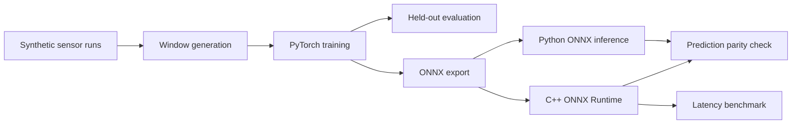

# Physics-Informed Edge AI for Precision Machining

A compact edge-AI research prototype for estimating thermal drift from temperature and vibration signals. The project explores a physics-inspired modeling approach and deploys a trained regression model through ONNX Runtime in both Python and C++.

> **Research prototype:** All experiments use synthetic data. The model has not been validated on real industrial machinery or Rollomatic equipment. Results represent a software proof of concept, not demonstrated industrial measurement accuracy.

## Project Goals

- Generate reproducible synthetic sensor sequences representing thermal warm-up and vibration.
- Train a compact PyTorch regression model to estimate future drift.
- Evaluate performance on independent held-out simulated runs.
- Export the model to ONNX for portable inference.
- Run inference from C++ using ONNX Runtime.
- Check Python/C++ prediction consistency and measure CPU inference latency.

## Architecture



## Model and Data

The synthetic dataset contains temperature-delta and vibration signals. Input samples use windows of 32 time steps and two features, with a future drift target.

The target generator includes linear temperature and vibration terms, a nonlinear temperature term, and noise. The compact neural network is trained with PyTorch and evaluated using run-level splits so windows from the same simulated run do not leak across training, validation, and test sets.

The approach is **physics-inspired**, not a strict physics-informed neural network (PINN). The data and results are simulated and should not be interpreted as evidence of performance on real machines.

## Held-Out Synthetic Evaluation

Previously recorded evaluation results:

| Metric | Neural model | Proxy baseline |
|---|---:|---:|
| MAE | 0.000525 mm | 0.001715 mm |
| RMSE | 0.000671 mm | 0.002012 mm |
| Maximum absolute error | 0.002488 mm | 0.005038 mm |

The neural model's MAE was approximately 69.4% lower than the proxy baseline on this held-out synthetic test set. These results describe only the simulated experiment; they do not establish real-world accuracy.

## ONNX and C++ Deployment

The trained model is exported to ONNX and loaded by ONNX Runtime in C++. The demo uses a synthetic input window with shape `[1, 32, 2]`.

A Python/C++ consistency check produced:

```text
Python ONNX prediction : 0.034147084 mm
C++ ONNX prediction    : 0.034147000 mm
Absolute difference    : 0.000000084 mm
Allowed tolerance      : 0.000010000 mm

PASS
```

The C++ output is rounded for display, which explains the small difference.

## C++ CPU Latency Benchmark

One recorded benchmark run on the development PC:

| Setting / metric | Value |
|---|---:|
| Runtime | ONNX Runtime CPU |
| Intra-op threads | 1 |
| Warm-up iterations | 100 |
| Measured iterations | 5,000 |
| Average latency | 14.859 µs |
| Median latency | 14.500 µs |
| P95 latency | 15.400 µs |
| P99 latency | 27.100 µs |

These figures are machine-dependent measurements of model inference calls. They exclude sensor acquisition, application startup, model loading, and end-to-end machine response time. They are a development benchmark, not a real-time guarantee.

## Requirements

- Python and the packages listed in `requirements.txt`
- CMake
- A compatible Microsoft C++ build toolchain on Windows
- ONNX Runtime C++ package compatible with the runtime linked by the project

The current development environment used Windows, MSVC, CMake, and ONNX Runtime 1.31.0.

## Reproduce the Python Experiments

From the repository root, activate your virtual environment, then run:

```powershell
python -m pip install -r requirements.txt
python scripts/generate_data.py
python scripts/train.py --epochs 50
python scripts/evaluate.py
python scripts/export_onnx.py
python -m pytest tests/ -v
```

Training and evaluation regenerate results from synthetic data, so exact metric values may change with configuration, random seeds, or software versions.

## Build and Run the C++ Demo

The ONNX Runtime C++ headers, import library, and runtime DLL are expected under `third_party/onnxruntime-win-x64-1.31.0/`.

```powershell
cmake -S . -B build -A x64
cmake --build build --config Release
.\build\Release\edge_ai_cpp.exe
```

Check Python/C++ prediction consistency with:

```powershell
python .\scripts\compare_cpp.py
```

## Tests

The current test suite covers dataset shape and finite values, run-level window isolation, invalid dataset configurations, and PyTorch/ONNX prediction parity. The latest recorded run passed all five tests.

## Limitations and Future Work

- Validate the approach using real, appropriately collected machine data.
- Compare against stronger, documented baselines.
- Add prediction-versus-target and residual plots.
- Repeat latency measurements across runs and target hardware.
- Assess robustness to sensor noise, operating conditions, and distribution shift.
- Evaluate deployment requirements before considering any production or safety-critical use.

No real Rollomatic machine data or industrial validation is included in this project.
